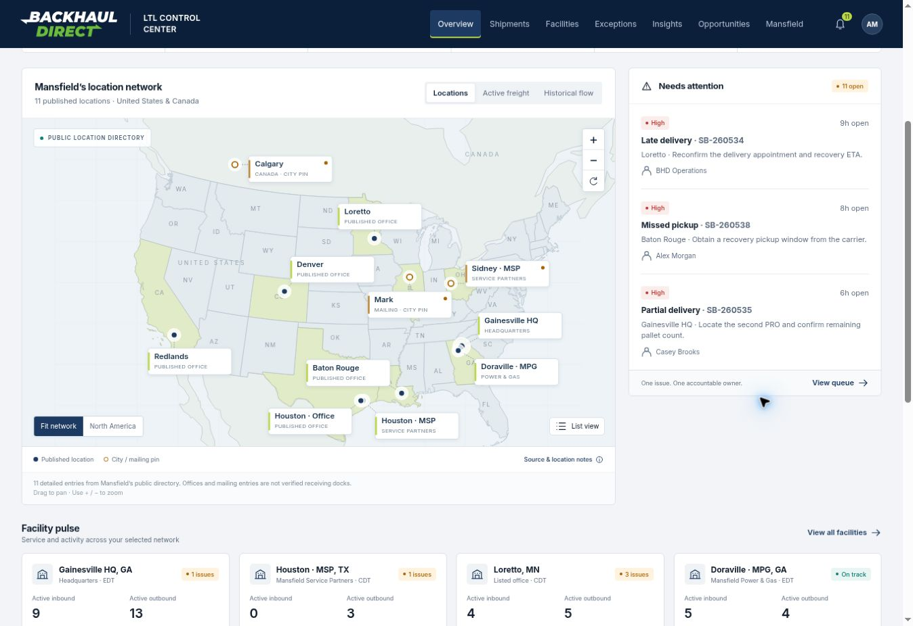

# BHD LTL Control Center

A Mansfield Energy Corp example built as a browser-local demonstration for Backhaul Direct's multi-facility LTL visibility product, styled to match Food It Forward. Sunnybrook remains the load system of record.

[Open the live dashboard](https://gregbhd.github.io/bhd-ltl-control-center/)

This repository contains the complete Mansfield update from Sites source commit `206fb3ea3bf61af8a56c0ed56047784f6ab165aa`. GitHub Pages publishes this repository from `main`. The separate ChatGPT Sites deployment is not synchronized by GitHub pushes. The app files match the original published Mansfield build.



## Run

No dependencies or build step are required. Use Node 20+ for model tests.

```sh
python3 -m http.server 8080 --directory dist
# Open http://localhost:8080
npm test
```

Sites deployment is configured in `.openai/hosting.json`; `dist/` is the static asset directory. The source repository stores the exact published source. Do not put credentials in these files.

## Demo walkthrough

1. Overview → select Gainesville HQ → Active shipments. Supporting unique loads reconcile to the KPI; Active freight mode shows the same load population.
2. Reset filters, switch the map to List view, and select a directional lane. Supporting loads retain the active-freight context.
3. Search `OD-781250-B`. Load `SB-260535` has two PROs, one delivered, and remains one active partial load.
4. Search `PO-450233`. `SB-260543` remains Unknown with an Oct 28 source update, despite the Oct 30 system sync.
5. Open Exceptions → Missed pickup. Assign an owner, add a note, supply a resolution reason, and resolve. Inspect audit history and verify the shipment is still Scheduled.
6. Open Insights for service denominators and separate invoiced/estimated spend. Facility spend in this chart is allocated once.
7. Export a filtered list. Save a named view or customize optional columns.
8. Open Opportunities → Three loads. One shared lane. Inspect three loads, assumptions, windows, and illustrative savings. Send for BHD review creates only a local review item.
9. Use the user avatar to illustrate corporate, facility, finance, BHD operations, and admin views. These are not authenticated roles.
10. Reset demo restores original synthetic data and removes local changes.

## Implemented

- Seven horizontal workspaces, including Mansfield-specific value tools; sticky BHD header; official white/lime logo; reference navy/lime tokens, cards, segmented KPIs, status pills, route chips, tables, and detail drawers.
- 176 deterministic synthetic shipments, 11 published locations, 5 carriers; fixed as-of 2026-10-30 16:00Z.
- Global dates, facility, direction, carrier, status, search, lane, and metric filters.
- Directional network flows with active/historical modes, volume/spend weighting, service issue highlighting, keyboard targets, and an accessible list alternative. Geographic boundaries are Census/Natural Earth-derived; directory address/city pins are source-labeled. No driven routes or live GPS are claimed.
- Facility comparison, arrivals/departures, local issue queue, major lanes, receiving details, and carrier performance.
- Searchable/sortable/paginated shipment table, saved views, optional columns, filtered CSV, multi-PRO handling, commitments vs ETA, source milestones, sample documents, and local conversation.
- Exception assignment, escalation, resolution reasons, notes, visibility labels, and an append-only browser-local activity history. Customer views hide internal notes in the interface.
- Customer spend, service samples, accessorial totals, invoice variance, report incidence, and resolution hours.
- Three opportunity types, supporting records, assumptions, service implications, and a deduplicated local review queue.
- Responsive 390px, 768px, and desktop layouts; focus states, modal focus trap, Escape close, empty results, initial loading state, recovery state, and browser-storage failure notice.

## Architecture

`dist/data.js`: deterministic seed, normalized records, filtering, metrics, exception mutations, CSV.
`dist/adapter.js`: DemoAdapter snapshot boundary; unconfigured SunnybrookAdapter explicitly fails until the live contract is supplied.
`dist/app.js`: UI, demo state, browser-local persistence (`bhd-ltl-mansfield-v2`), accessibility, interactions.
`dist/styles.css`: responsive Food It Forward-inspired design.
`tests/model.test.js`: business invariant tests.
`docs/INTEGRATION.md`: live integration contract and dependencies.
`docs/VALIDATION.md`: performed QA and remaining limits.

## Scope and limits

This is a synthetic demo, not an integrated production control tower. It has no live Sunnybrook connection, customer authentication, server-enforced permissions, shared communication, real documents, or outbound messages. The role switcher is illustrative; all demo data is downloaded to the browser. Real customer data must never be placed in this static demo or localStorage. No carrier buy rates, margins, or commissions exist in the dataset.

Food It Forward's `dist/network.css`, `dist/redesign.js`, and `dist/index.html` were inspected from `GregBHD/bhd-food-bank-network`. The existing application was not modified. No USPS source repository was found in connected searches, so no USPS code or integration claims are reused. The roadmap is historical context only.

## Mansfield update

Locations now use 11 detailed entries from Mansfield’s official public directory, with address conflicts and mailing/city-level pins explicitly flagged. The directory is not a verified receiving-site master. The redesigned map has sourced geography, readable labels, location/active/historical layers, pan, zoom, and a list alternative. Phones start in the readable directory view; the map remains one tap away.

The Mansfield workspace adds a fuel/DEF continuity scenario planner, a synthetic invoice/POD review queue, and local site-readiness annotations. Research and source notes are available in-app and in `docs/MAP-SOURCES.md`. Inventory/FuelNet remains unconnected. The 176 demo loads are conventional palletized LTL; a tank-wagon program needs a separate agreed data contract.

## GitHub Pages

The repository is prepared for GitHub Pages: choose **Deploy from a branch → main → / (root)** in Settings → Pages. The root entrypoint opens the current application in `dist/` and preserves shipment deep links. `.nojekyll` serves the static assets without a Jekyll build. Once hosting is enabled, changes to `main` are published by GitHub Pages.

GitHub Pages is enabled at https://gregbhd.github.io/bhd-ltl-control-center/ with HTTPS and public access; no sign-in is required. The repository was made public with owner approval. The existing private Sites demonstration is independent of GitHub Pages.
